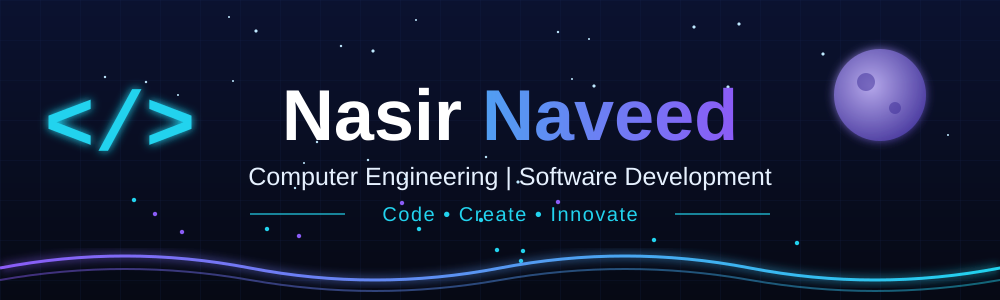
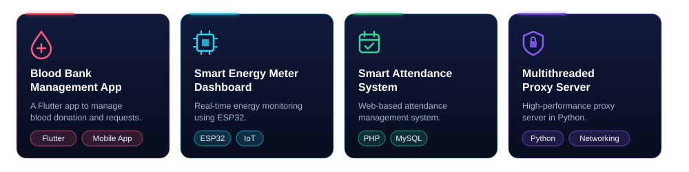

  

  

  

<table>
  <tr>
    <td width="240" align="center" valign="middle">
      
    </td>
    <td valign="middle">
      <h3>👋 Hey, I'm <b>Nasir Naveed</b></h3>
      
💻 <b>Computer Engineering Student | Aspiring Software Developer</b>

      
I'm a Computer Engineering student at SSUET, passionate about Software Development, Artificial Intelligence and modern technologies. I love turning ideas into code and solving real-world problems through innovation.

      

        
        
        
        
        
      

    </td>
  </tr>
</table>

<table>
  <tr>
    <td align="center"><b>Programming Languages</b></td>
    <td align="center"><b>Web Development</b></td>
    <td align="center"><b>Database</b></td>
    <td align="center"><b>Frameworks &amp; Hardware</b></td>
    <td align="center"><b>Tools &amp; Version Control</b></td>
  </tr>
  <tr>
    <td align="center"></td>
    <td align="center"></td>
    <td align="center"></td>
    <td align="center"></td>
    <td align="center"></td>
  </tr>
</table>

<table>
  <tr>
    <td>✅ <b>Artificial Intelligence &amp; Machine Learning</b></td>
    <td>✅ <b>Generative AI</b></td>
    <td>✅ <b>Modern Web Development</b></td>
    <td>✅ <b>Software Engineering</b></td>
  </tr>
</table>

  

  

  
  &nbsp;
  

  

