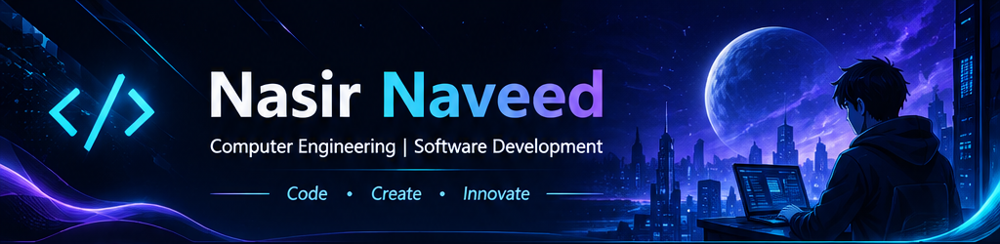
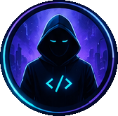
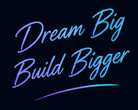
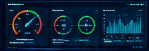

  

<table>
  <tr>
    <td width="190" align="center">
      
    </td>
    <td>
      <h2>👋 Hey, I'm <b>Nasir Naveed</b></h2>
      
💻 Computer Engineering Student | Aspiring Software Developer

      
<i>"Exploring Technology • Building Solutions • Creating Impact"</i>

    </td>
  </tr>
</table>

 

## 👤 About Me

<table>
  <tr>
    <td width="45%" valign="top">
      I'm a Computer Engineering student at SSUET, passionate about Software Development, Artificial Intelligence and modern technologies. I love turning ideas into code and solving real-world problems through innovation.
    </td>
    <td width="30%" valign="top">
      &lt;/&gt; Software Development 
      🧠 Artificial Intelligence &amp; ML 
      🌐 Web Development 
      ⚡ Problem Solving 
      📖 Lifelong Learning
    </td>
    <td width="25%" align="center">
      
    </td>
  </tr>
</table>

 

## 🛠️ Tech Stack &amp; Tools

<table>
  <tr>
    <td align="center"><b>Programming Languages</b></td>
    <td align="center"><b>Web Development</b></td>
    <td align="center"><b>Database</b></td>
    <td align="center"><b>Frameworks &amp; Hardware</b></td>
    <td align="center"><b>Tools &amp; Version Control</b></td>
  </tr>
  <tr>
    <td align="center"></td>
    <td align="center"></td>
    <td align="center"></td>
    <td align="center"></td>
    <td align="center"></td>
  </tr>
</table>

 

## 🚀 Currently Exploring &nbsp;&nbsp;|&nbsp;&nbsp; 📊 GitHub Statistics

<table>
  <tr>
    <td width="38%" valign="top">
      ✅ Artificial Intelligence &amp; Machine Learning  
      ✅ Generative AI  
      ✅ Modern Web Development  
      ✅ Software Engineering
    </td>
    <td width="62%" align="center">
      
    </td>
  </tr>
</table>

 

## 📁 Featured Projects

<table>
  <tr>
    <td width="25%" valign="top" align="center">
      
       <b>Blood Bank Management App</b>
       A Flutter app to manage blood donation and requests.
        
    </td>
    <td width="25%" valign="top" align="center">
      
       <b>Smart Energy Meter Dashboard</b>
       Real-time energy monitoring using ESP32.
        
    </td>
    <td width="25%" valign="top" align="center">
      
       <b>Smart Attendance System</b>
       Web-based attendance management system.
        
    </td>
    <td width="25%" valign="top" align="center">
      
       <b>Multithreaded Proxy Server</b>
       High-performance proxy server in Python.
        
    </td>
  </tr>
</table>

 

## 🤝 Connect With Me

  
  &nbsp;
  

  ⚡ <i>Always Learning. Always Building. Always Growing.</i>

  

