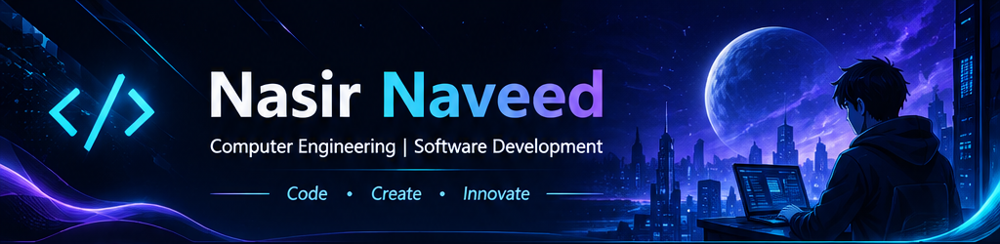
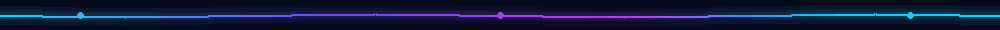

 

 

## 01 / ABOUT ME

**Hey, I'm Nasir Naveed** 👋

I'm a Computer Engineering student at **Sir Syed University of Engineering & Technology (SSUET)**, interested in software development, artificial intelligence, and practical technology solutions.

- 🎓 Computer Engineering student
- 💻 Interested in software development and web technologies
- 🤖 Exploring Artificial Intelligence, Machine Learning, and Generative AI
- ⚡ Interested in IoT, embedded systems, and hardware-software integration
- 🚀 Learning by building projects and solving real-world problems

## 02 / TECH STACK & TOOLS

**Programming Languages**

**Web Development**

**Database, Frameworks & Hardware**

**Tools & Version Control**

## 03 / CURRENTLY EXPLORING

| Focus area | Learning direction |
|:--|:--|
| 🤖 Artificial Intelligence | AI and Machine Learning fundamentals |
| ✨ Generative AI | Core concepts, tools, and practical applications |
| 🌐 Modern Web Development | Building useful and responsive web applications |
| 🧠 Software Engineering | Clean code, problem solving, and system design |

## 04 / FEATURED PROJECTS

| Project | Overview | Technologies |
|:--|:--|:--|
| 🩸 **Blood Bank Management App** | Flutter mobile app for blood donation and management workflows. | Flutter, Dart |
| ⚡ **Smart Energy Meter Dashboard** | IoT-based energy monitoring dashboard using an ESP32. | ESP32, IoT |
| 🎓 **Smart Attendance Management System** | Web-based attendance management system with teacher and student portals. | HTML, CSS, PHP, JavaScript, MySQL |
| 🌐 **Multithreaded Proxy Server** | Proxy server project demonstrating socket programming and multithreading. | Python, Sockets, Threading |
| 🛡️ **LabGuard-X — FYP (In Progress)** | Team project for centralized university computer-lab infrastructure monitoring and security. | Next.js, FastAPI, PostgreSQL, MQTT, ESP32 |

*Repository links will be added to each project as the corresponding repositories are published.*

## 05 / GITHUB ANALYTICS

 

## 06 / CONNECT WITH ME

  

**⚡ Always Learning. Always Building. Always Growing.**

 

*Thanks for visiting my profile!*

  CODE · CREATE · INNOVATE

